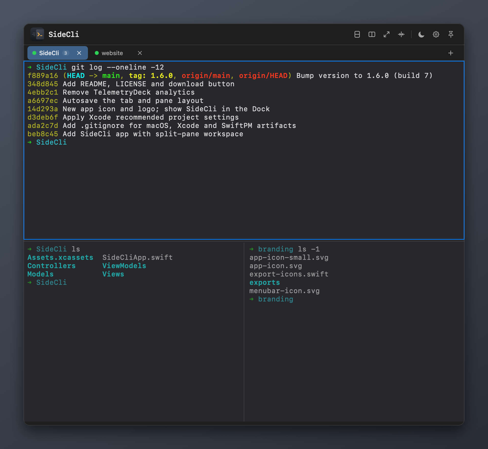
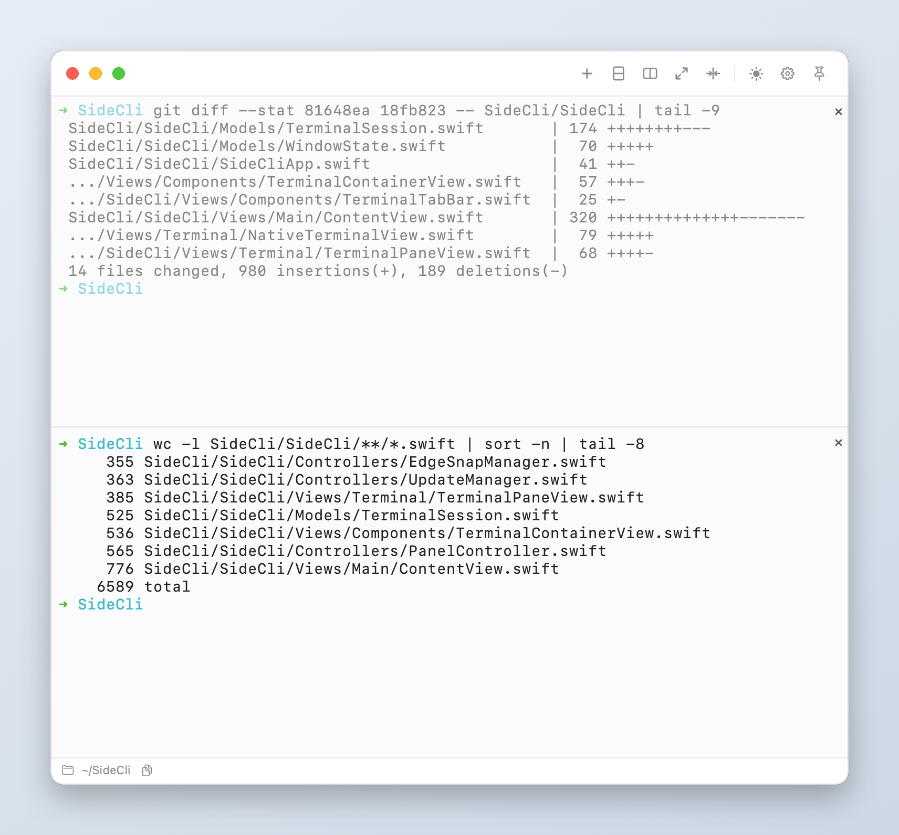

# SideCli

SideCli is a lightweight macOS terminal that lives on the edge of your screen:

- Snaps to the left or right screen edge and auto-hides to save space
- Slides out when the mouse reaches the edge, or with a global shortcut
- Native terminal rendering powered by SwiftTerm
- Shows in the menu bar and the Dock

<p align="center">
  
  
</p>

## Features

- Tabs, each with its own split panes: split top/bottom or left/right and nest freely
- `⌘D` picks the split direction with more room; panes keep a usable minimum size
- Zoom a pane to fill the panel, equalize panes, move focus between panes from the keyboard
- The panel widens automatically for left/right splits and shrinks back when they close
- Tabs, panes, ratios and working directories are saved continuously and restored on launch
- Configurable global shortcut, dark/light theme, font size, English/Chinese interface
- First-run welcome screen and quick tour
- No analytics or usage data collection

## Keyboard Shortcuts

| Action | Shortcut |
| --- | --- |
| New tab | `⌘T` |
| Close pane (closes the tab when it is the last pane) | `⌘W` |
| Split, automatic direction | `⌘D` |
| Split the other way | `⌘⇧D` |
| Zoom / restore pane | `⌘⇧↩` |
| Move between panes | `⌘⌥←` `⌘⌥→` `⌘⌥↑` `⌘⌥↓` |
| Font size | `⌘=` / `⌘-` |
| Show / hide panel (default, configurable) | ``⌘` `` |

## Requirements

- macOS 14.6 or later (Apple Silicon or Intel)
- Xcode 26 or later to build

## Build and Run

1. Open `SideCli/SideCli.xcodeproj` in Xcode.
2. Select the `SideCli` scheme.
3. Build and run.

Or with the command line:

```bash
xcodebuild -project "SideCli/SideCli.xcodeproj" -scheme "SideCli" -configuration Debug build
```

## Repository Layout

- `SideCli/` — the Xcode project and app sources
- `branding/` — SVG sources for the app, menu bar and logo icons, plus `export-icons.swift`, which regenerates every icon asset:

  ```bash
  swift branding/export-icons.swift
  ```

## Third-Party Software

- [SwiftTerm](https://github.com/migueldeicaza/SwiftTerm) — MIT License

## Download

[](https://github.com/yuting-ai/SideCli/releases/latest/download/SideCli.dmg)

## License

This project is licensed under the MIT License. See [LICENSE](./LICENSE).
